# 🐾 PetCare – Pet Care Management App

## 📌 Project Overview

PetCare is a mobile application developed using React Native to help pet owners manage their pets and their daily care needs.

The application allows users to store pet information, manage reminders, maintain pet health records, and access useful pet care guides. It uses a local SQLite database to store information on the device and supports offline functionality.

## ✨ Main Features

### 🐶 Pet Management
- Add new pets.
- View saved pet details.
- Store pet information in the local database.
- Delete pet records.

### 📚 Pet Care Guide
- Access pet care guides for different types of pets.
- Browse guides for dogs, cats, birds, and other pets.
- Filter guides by pet type.
- Filter guides by category.
- Search guides by title and description.
- Read detailed pet care information.

### ⏰ Reminder Management
- Create reminders with dates and times.
- Schedule local notifications.
- View saved reminders.
- Delete reminders.
- Cancel scheduled notifications when reminders are deleted.

### 🩺 Health Records Management
- Add health records for pets.
- Maintain vaccination, checkup, and medicine records.
- Save record dates, descriptions, and optional notes.
- View saved health records with pet details.
- Filter health records by record type.
- Delete health records.

### 🏠 Home Dashboard
- View a summary of pet information.
- Display the total number of saved pets.
- Display the total number of pet care guides.
- View reminder and health record information.

### 📶 Offline Functionality
- Uses a local SQLite database.
- Stores application data on the device.
- Supports the main application features without an active internet connection after the app has loaded.

## 📱 Application Screens

PetCare contains five main screens:

1. Home
2. My Pets
3. Pet Guide
4. Reminders
5. Health Records

The application uses Expo Router for navigation between screens.

## 🛠️ Technologies Used

- React Native
- Expo
- TypeScript
- Expo Router
- Expo SQLite
- Expo Notifications
- JavaScript
- Visual Studio Code

## 💾 Database

PetCare uses SQLite as its local database.

The database contains the following tables:

- `pets` – Stores pet information.
- `reminders` – Stores reminder details and notification IDs.
- `health_records` – Stores pet health records.
- `pet_guides` – Stores pet care guide information.

All application data is stored locally on the device.

## 🚀 Getting Started

### Prerequisites

Make sure you have the following installed:

- Node.js
- npm
- Visual Studio Code
- Expo Go (for testing on a mobile device)

### Installation

1. Clone the repository:

   ```bash
   git clone https://github.com/2022ict44/PetCare.git
   ```

2. Navigate to the project folder:

   ```bash
   cd PetCare
   ```

3. Install dependencies:

   ```bash
   npm install
   ```

4. Start the Expo development server:

   ```bash
   npx expo start
   ```

5. Scan the QR code using Expo Go to open the application on your mobile device.

## 🧪 Testing

The following functionalities have been tested:

- Adding and deleting pets.
- Viewing saved pet details.
- Accessing pet care guides.
- Filtering guides by pet type and category.
- Searching pet care guides.
- Viewing detailed guide information.
- Creating and deleting reminders.
- Local notification scheduling.
- Adding and deleting health records.
- Filtering health records by type.
- Navigation between all five screens.
- Input validation.
- Offline functionality.
- Data persistence after closing and reopening the app.

## 📸 Application Screenshots

The following screenshots demonstrate the main application screens:

### Home Screen
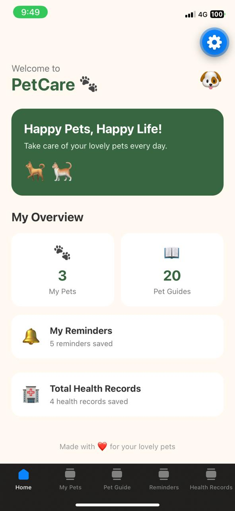


### My Pets Screen
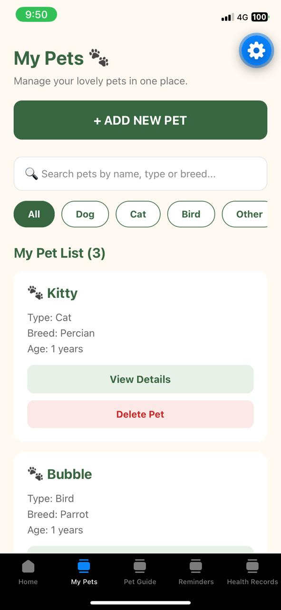


### Pet Guide Screen
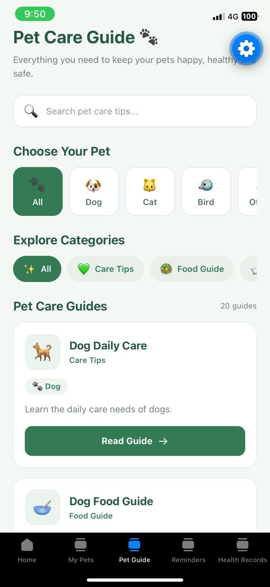


### Reminders Screen
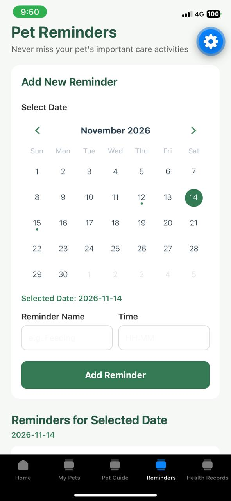


### Health Records Screen
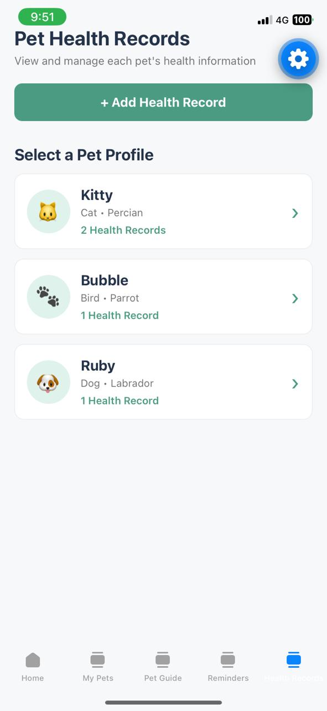


### Additional Application Features
### Add Pet
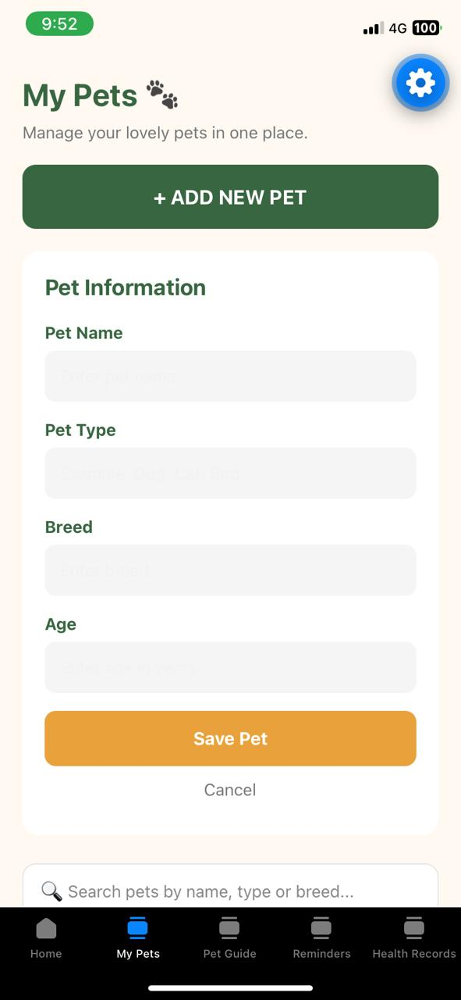


### Pet Details
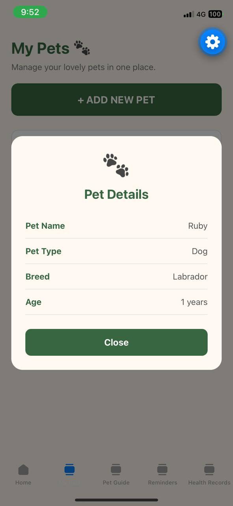


### Add Reminder
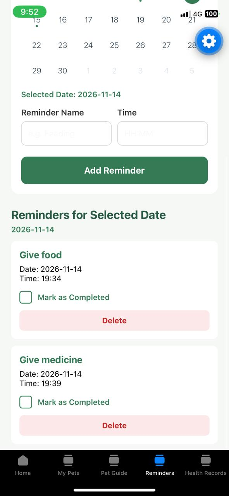


### Reminder Notification
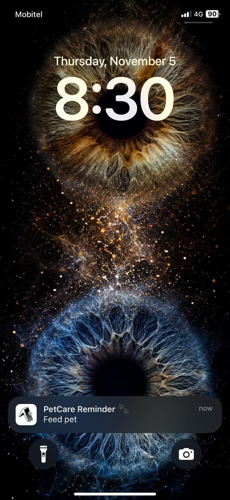


### Add Health Record
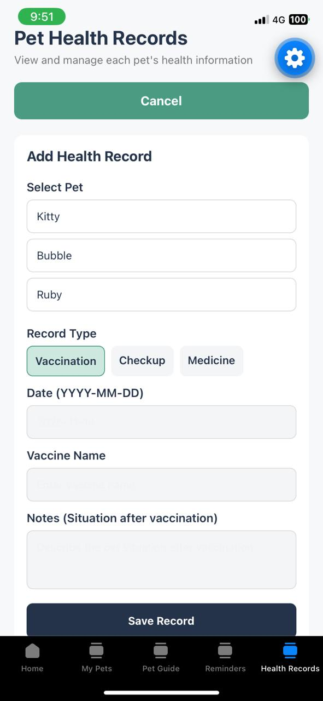


### Health History
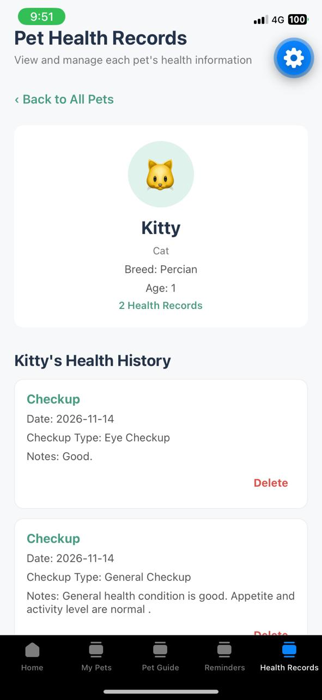


## 👩‍💻 Developer

**Project Name:** PetCare

**GitHub Repository:**  
https://github.com/2022ict44/PetCare

---

*PetCare – Making pet care easier!* 🐾